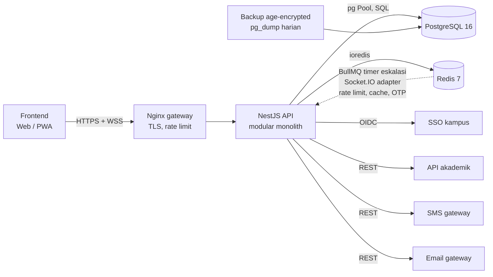

# Denger.in — Backend API

Backend platform kesehatan mental mahasiswa **Denger.in**: tombol darurat (Genta/SOS) dengan
eskalasi otomatis, booking dan sesi konseling terenkripsi end-to-end, cek mandiri PHQ-9/GAD-7,
curhat anonim, Circle dukungan sebaya, dan direktori layanan bantuan.

Dibangun sebagai **modular monolith** NestJS + PostgreSQL + Redis, dijalankan lewat Docker Compose
di belakang gateway Nginx (TLS).

---

## Daftar isi

- [Fitur](#fitur)
- [Arsitektur](#arsitektur)
- [Tech stack](#tech-stack)
- [Database](#database)
- [Menjalankan secara lokal](#menjalankan-secara-lokal)
- [Konfigurasi](#konfigurasi)
- [Pengembangan & testing](#pengembangan--testing)
- [Struktur repositori](#struktur-repositori)
- [Keamanan & privasi](#keamanan--privasi)
- [Dokumentasi lanjutan](#dokumentasi-lanjutan)

---

## Fitur

Tiga peran pengguna: **Mahasiswa** (login SSO kampus), **Psikolog**, dan **Dosen Admin** (login staf + MFA).

| Area | Fitur | PBI |
|---|---|---|
| **Autentikasi & akun** | SSO kampus (OIDC + PKCE), verifikasi status mahasiswa aktif ke sistem akademik, login staf argon2id + MFA TOTP, refresh token berotasi (deteksi reuse), lockout bertahap, RBAC global, ekspor & hapus data pribadi | 01–04 |
| **Genta (SOS darurat)** | Tombol SOS dengan konfirmasi dua langkah & anti-iseng, berbagi lokasi terenkripsi, notifikasi realtime ke psikolog jaga (< 5 dtk), dashboard antrean & ambil kasus atomik | 05–08 |
| **Eskalasi** | Timer eskalasi 3 menit (BullMQ + sweeper DB), SMS ke penerima kampus & kontak darurat, info hotline Healing119.id (119 ext. 8), konfigurasi oleh admin, kelola akun psikolog & jadwal jaga | 09 |
| **Konseling** | Booking slot (anti-bentrok dua lapis), ubah/batal sesi, jadwal & pelaksanaan sesi psikolog, ruang sesi **chat E2EE** + signaling WebRTC, ringkasan sesi berbasis consent, riwayat, pengingat H-24 jam & H-1 jam (in-app + email) | 10–14 |
| **Dukungan mahasiswa** | Cek mandiri PHQ-9 & GAD-7 (skor server, jalur bantuan segera), curhat anonim + balasan psikolog, Circle (telusuri, gabung, persetujuan admin, rekomendasi, moderasi pendamping), direktori sumber daya | 15–19 |

Daftar endpoint lengkap tersedia di Swagger (`/api/docs`) saat berjalan non-produksi, dan
rinciannya per fitur di [`docs/`](docs/README.md).

---

## Arsitektur



**Prinsip utama**

- **Modular monolith.** Tiap domain adalah modul NestJS terpisah (`apps/api/src/modules/*`) yang
  berkomunikasi lewat service yang diekspor. Kode lintas modul (auth, enkripsi, audit, Redis,
  konfigurasi) ada di `apps/api/src/common/*`.
- **SQL eksplisit.** Akses data memakai `pg` Pool dengan query berparameter, bukan ORM entity.
  TypeORM hanya dipakai sebagai runner migrasi. Invarian penting ditegakkan di database
  (exclusion constraint, CHECK, indeks unik parsial), bukan hanya di aplikasi.
- **Aman multi-instance.** Timer eskalasi di BullMQ, penanda sekali pakai dan rate limit di Redis,
  worker memakai klaim `FOR UPDATE SKIP LOCKED`, dan Socket.IO memakai adapter Redis.
- **Fitur keselamatan gagal terbuka secara terukur.** SOS tetap bisa dikirim saat Redis atau API
  akademik gangguan, sedangkan login staf dan MFA gagal tertutup.

**Realtime (Socket.IO)**

| Namespace | Peran | Kegunaan |
|---|---|---|
| `/psikolog` | Psikolog | `sos:baru`, `sos:diperbarui`, `sos:eskalasi`, `sos:lokasi`, `booking:*` |
| `/sesi` | Mahasiswa & psikolog sesi | Chat ciphertext E2EE, signaling WebRTC, status sesi |

**Proses latar** (berjalan di setiap instance API, aman berbarengan)

| Proses | Interval | Fungsi |
|---|---|---|
| Worker BullMQ eskalasi | delayed job | Eskalasi SOS yang tidak diambil dalam durasi konfigurasi |
| Sweeper eskalasi | 30 dtk | Cadangan bila timer Redis hilang + ulangi SMS eskalasi yang tertunda |
| Sinkron `status_jaga` | 60 dtk | Turunan jadwal jaga untuk tampilan |
| Worker pengingat sesi | 60 dtk | Notifikasi in-app + email dengan retry |

---

## Tech stack

| Lapisan | Teknologi |
|---|---|
| Runtime | Node.js 22, TypeScript 5 (strict) |
| Framework | NestJS 11 (Express) |
| Database | PostgreSQL 16 (`pg`), migrasi TypeORM 0.3 (raw SQL) |
| Cache / antrean | Redis 7 (`ioredis`), BullMQ 5 |
| Realtime | Socket.IO 4 + `@socket.io/redis-adapter` |
| Auth | `openid-client` 6 (OIDC + PKCE), JWT RS256 (`@nestjs/jwt`), argon2id, TOTP (RFC 6238) |
| Kriptografi | AES-256-GCM dengan AAD per baris + rotasi kunci; HKDF; E2EE di klien (ECDH P-256/X25519) |
| Validasi | `class-validator` + `class-transformer` (whitelist, tolak field tak dikenal) |
| Keamanan HTTP | Helmet, CORS ketat, `@nestjs/throttler` (storage Redis) |
| Observability | `nestjs-pino` (log JSON, redaksi header sensitif), health check `/health/live` & `/health/ready` |
| Dokumentasi API | `@nestjs/swagger` (OpenAPI 3) |
| Testing / lint | Jest + Supertest + socket.io-client, oxlint |
| Infrastruktur | Docker Compose, Nginx (TLS), backup `pg_dump` terenkripsi [age](https://age-encryption.org) |

---

## Database

PostgreSQL 16 dengan ekstensi `citext` dan `btree_gist`. Skema awal ada di
[`apps/api/src/database/sql/0001_init.sql`](apps/api/src/database/sql/0001_init.sql);
setiap perubahan berikutnya berupa migrasi di
[`apps/api/src/database/migrations/`](apps/api/src/database/migrations).

| Kelompok | Tabel utama |
|---|---|
| Akun | `mahasiswa`, `psikolog`, `dosen_admin`, `refresh_token`, `kunci_e2ee`, `kontak_darurat` |
| Genta & eskalasi | `log_sos`, `log_eskalasi`, `konfigurasi_sos`, `penerima_eskalasi`, `jadwal_jaga` |
| Konseling | `sesi_konseling`, `sesi_pesan` (ciphertext saja), `pengingat_sesi` |
| Cek mandiri | `template_kuesioner`, `hasil_cek_mandiri` |
| Curhat | `curhat_anonim`, `curhat_balasan`, view `v_curhat_untuk_psikolog` (tanpa identitas) |
| Circle | `kategori_minat`, `preferensi_minat`, `circle`, `keanggotaan_circle`, `circle_pesan` |
| Lainnya | `sumber_daya`, `notifikasi`, `audit_log` (append-only), view `v_laporan_*` |

**Role database (least privilege)**

| Role | Dipakai oleh | Hak |
|---|---|---|
| `denger_owner` | Service `migrate` | DDL penuh |
| `denger_app` | API | DML pada tabel aplikasi; **tanpa** `UPDATE/DELETE/TRUNCATE` pada `audit_log` |
| `denger_report` | Modul laporan | `SELECT` hanya pada view `v_laporan_*` |

Contoh invarian yang dijaga database: sesi konseling tidak bisa bentrok (exclusion constraint
`tstzrange`), satu SOS aktif per mahasiswa (indeks unik parsial), ringkasan sesi mustahil
tersimpan tanpa consent (CHECK), dan Circle aktif wajib punya pendamping (CHECK).

---

## Menjalankan secara lokal

### Prasyarat

- Docker Desktop (Compose v2)
- Node.js 22 (untuk membuat kunci dev dan menjalankan test di host)

### 1. Siapkan environment

```powershell
Copy-Item .env.example .env
```

Isi `ENCRYPTION_KEY_1` di `.env` (wajib; aplikasi tidak mau start tanpanya):

```powershell
node -e "console.log(require('crypto').randomBytes(32).toString('base64'))"
```

### 2. Buat kunci JWT development (sekali saja)

```powershell
node infra/auth/generate-dev-jwt-keys.cjs
```

### 3. Jalankan semua service

```powershell
docker compose up --build -d
docker compose ps
```

Compose menjalankan `postgres`, `redis`, `migrate` (menerapkan semua migrasi lalu berhenti
dengan kode 0), `api` (hot reload), dan `gateway` (Nginx, sertifikat self-signed untuk dev).

| URL | Keterangan |
|---|---|
| `https://localhost/health/live` | Proses hidup |
| `https://localhost/health/ready` | PostgreSQL + Redis terjangkau |
| `https://localhost/api/v1/...` | API |
| `https://localhost/api/docs` | Swagger UI (non-produksi) |

Port 80/443 sudah terpakai? Atur `GATEWAY_HTTP_PORT` / `GATEWAY_HTTPS_PORT` di `.env`. Pakai `curl.exe -k`
atau terima peringatan sertifikat di browser.

### 4. Akun uji

```powershell
# akun uji development: admin.test@denger.local, psikolog.test@denger.local, mahasiswa TEST-DEV-0001
docker compose exec -e DEV_AUTH_SEED=true -e DEV_AUTH_PASSWORD='GantiPasswordIni-2026!' api npm run seed:dev-auth

# akun dosen admin sungguhan (boleh di produksi; password sementara tampil sekali)
docker compose exec api npm run admin:buat -- --np 198001012005011001 --nama "Nama Admin" --email admin@kampus.ac.id
```

Login mahasiswa memakai SSO kampus. Untuk dev, isi `OIDC_*` di `.env` dan cantumkan NIM uji di
`AKADEMIK_MOCK_ACTIVE_NIMS` (lihat [`docs/PBI-01-oidc-mock-testing.md`](docs/PBI-01-oidc-mock-testing.md)).

### 5. Isi data awal (lewat akun Dosen Admin)

Kategori minat (untuk Circle) dan direktori sumber daya sengaja tidak di-seed karena kontennya
ditetapkan PO. Isi lewat `POST /api/v1/admin/kategori-minat` dan `POST /api/v1/admin/sumber-daya`,
minimal **Healing119.id — 119 ext. 8**. Template PHQ-9/GAD-7 v1 sudah ditanam migrasi.

### Menghentikan

```powershell
docker compose down      # data tetap tersimpan
docker compose down -v   # hapus juga volume database & Redis
```

Backup terenkripsi harian dapat diaktifkan dengan `docker compose --profile backup up -d`
setelah mengisi `BACKUP_AGE_RECIPIENT` (lihat [`docs/README.md`](docs/README.md#enkripsi-data-dan-backup)).

---

## Konfigurasi

Semua konfigurasi lewat environment variable. Daftar lengkap beserta default ada di
[`.env.example`](.env.example). Aplikasi **memvalidasi seluruh env saat boot** dan gagal start
dengan daftar kesalahan bila ada yang salah.

| Kelompok | Variabel penting |
|---|---|
| Rahasia (wajib) | `DATABASE_URL`, `JWT_PRIVATE_KEY_PATH`, `JWT_PUBLIC_KEY_PATH`, `ENCRYPTION_ACTIVE_KEY_ID`, `ENCRYPTION_KEY_<id>` |
| Web | `CORS_ORIGINS`, `FRONTEND_LOGIN_SUCCESS_URL`, `FRONTEND_LOGIN_FAILURE_URL`, `TRUST_PROXY` |
| SSO & akademik | `OIDC_ISSUER_URL`, `OIDC_CLIENT_ID`, `OIDC_CLIENT_SECRET`, `OIDC_REDIRECT_URI`, `AKADEMIK_MODE` (`mock`/`http`) |
| Integrasi | `SMS_PROVIDER`, `EMAIL_PROVIDER` (`console` untuk dev, **`http` wajib di produksi**) |
| Staf | `STAFF_MFA_REQUIRED` (default `true` di produksi) |
| Perilaku fitur | `BOOKING_*`, `SESI_*`, `SOS_*`, `PENGINGAT_*`, `CEK_MANDIRI_*`, `CURHAT_*`, `CIRCLE_*` |

Konfigurasi yang diubah admin saat runtime (durasi eskalasi, hotline, ambang anti-iseng,
penerima SMS) disimpan di tabel `konfigurasi_sos`, bukan env.

---

## Pengembangan & testing

Semua perintah dijalankan dari `apps/api`:

```powershell
cd apps/api
npm ci                       # lockfile harus sinkron (Dockerfile & CI memakai npm ci)
npm run lint                 # oxlint
npm run typecheck            # tsc --noEmit
npm test -- --runInBand      # unit test (Jest)
npm run build                # kompilasi ke dist/
```

E2E dijalankan terhadap service Compose yang aktif:

```powershell
docker compose exec api npm run test:e2e -- --runInBand
```

| Perintah | Fungsi |
|---|---|
| `npm run start:dev` | API dengan hot reload (dipakai container `api`) |
| `npm run migration:run` / `migration:revert` / `migration:show` | Migrasi (satu transaksi per migrasi, `-t each`) |
| `npm run seed:dev-auth` | Akun uji (hanya `NODE_ENV=development`) |
| `npm run admin:buat` | Buat atau reset (`--reset`) akun dosen admin |

**Konvensi:** satu perubahan skema = satu file migrasi baru (jangan mengedit migrasi yang sudah
di-merge). Nama commit mengikuti subtask Jira, mis. `SCRUM-258 konfigurasi fitur cek mandiri`.

---

## Struktur repositori

```
dia-backend/
├─ apps/api/                    # NestJS API
│  ├─ src/
│  │  ├─ main.ts, app.module.ts, app.setup.ts
│  │  ├─ common/                # lintas modul
│  │  │  ├─ auth/               # SSO, JWT, MFA, guard RBAC, lockout
│  │  │  ├─ crypto/             # EncryptionService (AES-256-GCM + AAD)
│  │  │  ├─ audit/              # AuditService (append-only)
│  │  │  ├─ config/             # validasi env saat boot
│  │  │  ├─ logging/            # pino + Swagger
│  │  │  ├─ redis/ health/ domain/
│  │  ├─ modules/
│  │  │  ├─ akademik/ akun/     # verifikasi mahasiswa, data pribadi
│  │  │  ├─ genta/ eskalasi/ realtime/   # SOS, eskalasi + SMS, Socket.IO psikolog
│  │  │  ├─ admin-staf/         # akun psikolog & jadwal jaga
│  │  │  ├─ booking/ sesi/ notifikasi/   # konseling, ruang E2EE, pengingat
│  │  │  ├─ cek-mandiri/ curhat/ circle/ sumber-daya/
│  │  ├─ database/              # sql/, migrations/, seed/, transaksi.ts
│  ├─ test/                     # e2e
│  └─ Dockerfile                # target dev / build / prod (non-root)
├─ infra/
│  ├─ gateway/                  # Nginx (TLS, proxy WebSocket, rate limit)
│  ├─ auth/                     # generator kunci JWT dev
│  └─ backup/                   # pg_dump terenkripsi age
├─ docs/                        # rancangan (02, 04) + dokumen per PBI
├─ docker-compose.yml
└─ .env.example
```

---

## Keamanan & privasi

- **Enkripsi data sensitif di aplikasi:** keluhan, ringkasan sesi, jawaban cek mandiri, curhat,
  lokasi SOS, nomor telepon, dan secret MFA dienkripsi AES-256-GCM dengan AAD
  `tabel:kolom:id_baris`, sehingga ciphertext tidak bisa dipindah antarbaris.
- **E2EE chat konseling:** server hanya menyimpan kunci publik dan ciphertext.
- **Anonimitas:** curhat dan Circle memakai alias; psikolog membaca curhat lewat view tanpa
  identitas; Dosen Admin hanya melihat agregat dan metadata.
- **Audit log append-only** untuk akses data sensitif (lokasi SOS, ringkasan, riwayat, curhat,
  moderasi, perubahan konfigurasi, login gagal).
- **Sesi:** access token 15 menit, refresh token di cookie `HttpOnly; Secure` dengan rotasi dan
  deteksi reuse, cek `Origin` untuk refresh/logout.
- **Log** tidak memuat token, cookie, query string, atau isi body.

Batasan yang diketahui dan keputusan yang masih menunggu PO tercatat di
[`docs/README.md`](docs/README.md#batasan-yang-diketahui).

---

## Dokumentasi lanjutan

| Dokumen | Isi |
|---|---|
| [`docs/README.md`](docs/README.md) | Panduan operasional: menjalankan, tes, backup, migrasi, batasan |
| [`docs/02-backend.md`](docs/02-backend.md) | Rancangan backend: modul, katalog endpoint, aturan domain |
| [`docs/04-database.md`](docs/04-database.md) | Rancangan database: DDL, role, retensi |
| `docs/PBI-01` … `docs/PBI-19` | Perilaku yang sudah diimplementasikan per fitur, kode error, cara uji |

Bila rancangan (02/04) berbeda dengan dokumen PBI, **dokumen PBI yang berlaku**.
